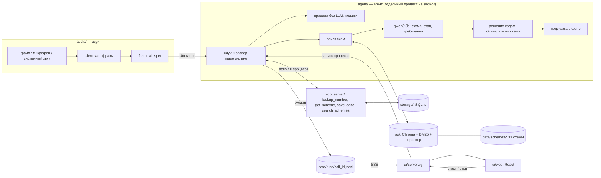

# Антимошенник

Локальный ИИ-агент, который слушает телефонный разговор и помогает не попасться мошенникам.
Он распознаёт речь, по репликам находит схему развода и её этап, сразу предупреждает, когда звучит
опасное требование («продиктуйте код из СМС», «переведите на безопасный счёт»), подсказывает, что
ответить, чтобы потянуть время, и всегда показывает безопасный выход — положить трубку и перезвонить
самому. После звонка агент пишет отчёт и сохраняет кейс; при следующем звонке с того же номера он
сразу предупредит.

Всё работает на ноутбуке **без интернета**: распознавание речи (faster-whisper), языковая модель
(qwen3:8b через Ollama), поиск по базе схем (RAG) и инструменты агента (MCP). Интернет нужен один раз —
чтобы всё установить.

> Кейс-чемпионат по локальному ИИ-агенту, вариант А: индексация + RAG + инструменты через MCP.

---

## Быстрый старт

Если всё уже установлено (иначе — [Установка](#установка)), из папки проекта:

```bash
ollama serve
```

```bash
.venv/bin/python -m ui.server
```

Откройте http://127.0.0.1:8642 — экран «Новый звонок». Выберите тестовый звонок (например,
`002.wav` — «Родственник в беде») и нажмите «Старт». Без модели можно проиграть готовый
демо-звонок: режим «Демо без модели» на том же экране.

---

## Содержание

- [Сценарий работы](#сценарий-работы)
- [Требования к железу](#требования-к-железу)
- [Установка](#установка)
- [Запуск](#запуск)
- [Демо за 3 команды](#демо-за-3-команды)
- [Архитектура](#архитектура)
- [Как это работает](#как-это-работает)
- [Структура репозитория](#структура-репозитория)
- [Данные](#данные)
- [Результаты](#результаты)
- [Частые проблемы](#частые-проблемы)
- [Тесты](#тесты)
- [Команда](#команда)
- [Ограничения](#ограничения)

---

## Сценарий работы

1. **Звук → реплики.** Звук звонка (файл, микрофон на громкой связи или системный звук) режется
   детектором речи (silero-vad) на фразы, каждая фраза распознаётся faster-whisper.
2. **Мгновенные предупреждения.** Каждая фраза звонящего сразу проверяется правилами по ключевым
   словам — без модели, за доли секунды: «код из СМС», «перевод», «наличные», «данные карты»,
   «установите приложение», «никому не говорите» и т. п.
3. **Поиск схемы.** По последним репликам агент ищет похожие этапы в базе из 33 схем развода
   (гибридный поиск: векторы bge-m3 + BM25 + реранкер).
4. **Разбор моделью.** qwen3:8b по найденным этапам определяет схему, этап и дословные требования
   мошенника; ответ — строго JSON. Объявлять ли схему, решает код: модель должна быть уверена, а
   требование — действительно прозвучать.
5. **Экран.** Агент показывает схему и её этап, что мошенник сделает дальше, красные плашки,
   реплику, чтобы потянуть время, и безопасный выход.
6. **Инструменты (MCP).** В начале звонка — проверка номера по истории (`lookup_number`),
   при объявлении схемы — схема целиком (`get_scheme`), в конце — сохранение кейса (`save_case`).
7. **Отчёт.** После звонка: схема, до какого этапа дошёл мошенник, кем представлялся, ключевые фразы.

Если мошенник уже требует деньги или код, а ни одна схема не подходит, звонок помечается
**«Мошенничество (схема не определена)»** — агент не молчит.

---

## Требования к железу

| | Минимум | Проверено на |
|---|---|---|
| Память | 16 ГБ (запасной режим — 8 ГБ с qwen3:4b) | MacBook на Apple Silicon (arm64), 16 ГБ |
| Диск | ~10 ГБ: модели ~7 ГБ, зависимости Python ~1,5 ГБ | |
| ОС | macOS или Linux; Windows не проверялась | macOS |
| Процессор / GPU | любой; на Apple Silicon Ollama использует GPU (Metal) | |

Сколько занимают модели (замер `ollama ps` на проверочном ноутбуке): qwen3:8b — 5,6 ГБ, bge-m3 —
0,7 ГБ; Whisper small — около 1 ГБ (оценка). Вместе с ОС и браузером укладывается в 16 ГБ.

---

## Установка

Нужен интернет. Всё ставится один раз, дальше проект работает офлайн.

**Что должно быть заранее:** git с [Git LFS](https://git-lfs.com), Python **3.12**,
Node.js **20+** (только для сборки интерфейса), [Ollama](https://ollama.com).
На macOS: `brew install git-lfs node ollama`.

### 1. Код и записи звонков

```bash
git clone https://github.com/W1rmwood/antifraud-agent && cd antifraud-agent
```

```bash
git lfs install && git lfs pull
```

Записи тестовых звонков (`data/calls/*.wav`) лежат в Git LFS: без `git lfs pull` вместо звука будут
текстовые указатели.

### 2. Окружение Python 3.12

```bash
python3.12 -m venv .venv && .venv/bin/pip install -r requirements.txt
```

Если до PyPI медленная сеть и `pip` обрывается — то же через [uv](https://docs.astral.sh/uv/) с длинным
таймаутом и параллельной загрузкой:

```bash
UV_HTTP_TIMEOUT=1800 UV_CONCURRENT_DOWNLOADS=16 uv pip install --python .venv/bin/python -r requirements.txt
```

### 3. Модели Ollama

```bash
ollama serve
```

В другом окне:

```bash
ollama pull qwen3:8b && ollama pull bge-m3
```

Для машины с 8 ГБ — `ollama pull qwen3:4b` и переменная `ANTIFRAUD_LLM_MODEL=qwen3:4b` при запуске.

### 4. Модель распознавания речи

Скачивается при первом распознавании, а во время звонка интернета нет — поэтому один раз заранее:

```bash
.venv/bin/python -c "from faster_whisper import WhisperModel; WhisperModel('small')"
```

### 5. Индекс схем и демо-база

```bash
.venv/bin/python -m rag.index
```

```bash
.venv/bin/python -m storage.seed_demo
```

Индекс (`data/chroma/`) пересобирается после любой правки `data/schemes/`. Демо-база —
20 вымышленных номеров с историей звонков; команда пересоздаёт её с нуля.

### 6. Интерфейс

```bash
cd ui/web && npm ci && npm run build && cd ../..
```

### 7. Проверка

```bash
.venv/bin/python -m pytest -q
```

После этого можно выключить интернет: запуск и звонки работают без сети. На экране «Новый звонок»
блок «Готовность» показывает, всё ли на месте (модели, индекс, база, записи, распознавание речи), и
команду, которая исправит то, чего не хватает.

---

## Запуск

```bash
ollama serve
```

```bash
.venv/bin/python -m ui.server
```

Интерфейс — http://127.0.0.1:8642 (другой порт: `--port 8700`).

| Экран | Что там |
|---|---|
| Новый звонок | живой звонок с микрофона, загрузка записи, тестовые звонки, демо без модели; «Готовность» |
| Звонок | разговор с подсветкой опасных фраз, безопасный выход, «что сказать», схема и этапы, признаки, действия агента |
| Отчёт | схема, ход развода по этапам, требования, подсказки, ключевые фразы |
| История | прошлые звонки, поиск по номеру с историей |
| Схемы | каталог из 33 схем развода с этапами |

Живой звонок с микрофона: звонок по громкой связи рядом с ноутбуком. При первом запуске macOS спросит
разрешение на микрофон для терминала, в котором запущен `ui.server`.

**Без интерфейса** — один звонок в терминале (контракт №7):

```bash
.venv/bin/python -m agent.run data/calls/001.wav --phone +79990000001 --realtime
```

```bash
.venv/bin/python -m agent.run --mic
```

`--realtime` выдаёт реплики файла в темпе живого разговора, `--json` печатает сырые события.
Звонок с микрофона заканчивается по Ctrl+C: агент допишет отчёт и сохранит кейс.

### Настройки

Переменные окружения с префиксом `ANTIFRAUD_` (полный список — `agent/config.py`):

| Переменная | По умолчанию | Что это |
|---|---|---|
| `ANTIFRAUD_LLM_MODEL` | `qwen3:8b` | модель разбора и подсказок |
| `ANTIFRAUD_EMBED_MODEL` | `bge-m3` | эмбеддинги для поиска |
| `ANTIFRAUD_WHISPER_MODEL` | `small` | распознавание речи (`medium` точнее, но в 2,5 раза медленнее) |
| `ANTIFRAUD_DETECT_THRESHOLD` | `0.6` | порог уверенности для объявления схемы |
| `ANTIFRAUD_WINDOW_SIZE` | `8` | сколько последних реплик видит модель |
| `ANTIFRAUD_DB` | `data/antifraud.db` | база номеров и кейсов |
| `ANTIFRAUD_LOOPBACK_DEVICE` | — | устройство системного звука (например, `BlackHole`) |

---

## Демо за 3 команды

```bash
ollama serve
```

```bash
.venv/bin/python -m ui.server
```

```bash
open http://127.0.0.1:8642   # macOS; на Linux — xdg-open или просто браузер
```

Дальше — «Новый звонок» → тестовый звонок `002.wav` («Родственник в беде») → «Старт».
За минуту разговора агент покажет плашки «Признак развода: наличные / курьер», схему
«Родственник в беде (ДТП)» с этапом «Следователь или адвокат», подсказку «Положите трубку и
перезвоните родственнику на его обычный номер» и реплику, чтобы потянуть время; после звонка — отчёт.

**Запасной вариант без модели** (если на защите что-то упадёт): «Новый звонок» → «Демо без модели» —
проигрывает записанный прогон `data/runs/demo.jsonl` в том же интерфейсе, с настоящими паузами.

> Скриншоты экранов: `docs/img/` — добавить с защитного ноутбука.

---

## Архитектура



- **Модули общаются через контракты** (`contracts/models.py`, Pydantic): схема развода, реплика
  `Utterance`, события агента `AgentEvent`, кейс `CallCase`, запрос на звонок `CallRequest`. Поэтому их
  можно делать и тестировать отдельно, на фейках (`tests/fakes/`).
- **Агент и интерфейс — разные процессы.** Агент пишет события в `data/runs/<call_id>.jsonl` (одна строка —
  одно событие), мост `ui/server.py` отдаёт их браузеру потоком Server-Sent Events. Живой звонок и
  проигрывание записи идут одним и тем же кодом экранов.
- **Инструменты вызывает код, а не модель.** `lookup_number`, `get_scheme` и `save_case` агент зовёт в
  заранее известные моменты: модели на 8B выбор инструментов не доверяем. `search_schemes` и
  `list_recent_cases` доступны и модели.

---

## Как это работает

### Индексация (`rag/index.py`)
Один чанк — один этап схемы: типичные фразы мошенника, название и цель этапа, красные флаги, что
просят, плюс метаданные `scheme_id`, `stage_n`, `category`. Эмбеддинги — bge-m3 через Ollama, хранилище —
Chroma на диске. Команда: `python -m rag.index`, около 6 секунд на 109 этапов.

### Поиск (`rag/retriever.py`)
Гибрид: векторный поиск и BM25 (слова обрезаются до основы), результаты сливаются RRF и
переранжируются FlashRank (многоязычная модель `ms-marco-MultiBERT-L-12`). Ищется только по словам
звонящего из окна последних 8 реплик. Модели отдаются 5 лучших этапов-кандидатов.

### Агент (`agent/`)
- **Граф на LangGraph** (`graph.py`): поиск → разбор LLM → решение кодом. Подсказка генерируется в фоне,
  не задерживая следующий разбор.
- **Реальное время** (`run.py`): «слух» и «разбор» идут параллельно. Транскрипт попадает на экран сразу;
  реплики, накопившиеся, пока модель думала, разбираются одной пачкой — очередь не растёт.
- **Правила без LLM** (`rules.py`): мгновенные плашки по сочетаниям ключевых слов с вето на
  формулировки настоящих организаций («никому не сообщайте код» в устах банка — не тревога).
- **Решение кодом** (`policy.py`): схема объявляется, только если модель уверена (≥ 0,6), схема есть
  среди найденных, а требование дословно прозвучало. Объявленная схема меняется, только если новая
  увереннее на 0,15 или выигрывает два хода подряд. Общая метка «схема не определена» — только при
  двух признаках сразу: требование от модели и срабатывание правил.
- **Ответы модели** (`llm.py`, `prompts.py`): строго JSON по Pydantic-схеме (параметр `format` Ollama),
  thinking выключен, до двух повторов при невалидном ответе, модель держится в памяти между вызовами.
- **Подсказки безопасны:** не просят называть настоящие данные, переводить деньги или ставить
  приложения; безопасный выход «положите трубку и перезвоните…» пишет код по категории схемы и
  показывает всегда, когда есть признаки развода.

### MCP-инструменты (`mcp_server/server.py`)
FastMCP-сервер: `search_schemes`, `get_scheme`, `lookup_number`, `save_case`, `list_recent_cases`.
Работает в процессе агента или отдельно по stdio (`python -m mcp_server.server`).

### Звук (`audio/`)
- Файл: чтение и приведение к 16 кГц; в стерео левый канал — звонящий, правый — абонент, в моно роли
  определяет модель по смыслу.
- Живой звук: микрофон или системный звук (`sounddevice`; на macOS — через BlackHole), потоковый
  silero-vad, Whisper в отдельном потоке — звук не теряется, пока распознаётся предыдущая фраза.
- Фильтр выдумок Whisper: на шуме он «досочиняет» титры и концовки роликов из субтитров
  («Подписывайтесь на канал», «ПОЛИЦЕЙСКАЯ СИРЕНА») — такие обрывки отбрасываются.

### Хранилище (`storage/db.py`)
SQLite: номера (`numbers`) и кейсы звонков (`calls`). Номер приводится к `+7XXXXXXXXXX`; неизвестный
номер — `calls_count = 0`, а не ошибка.

### Интерфейс (`ui/`)
React (Vite) в `ui/web` и HTTP-мост `ui/server.py` на стандартной библиотеке поверх
`agent/ui_api.py`: запуск и остановка звонка отдельным процессом, поток событий (SSE), загрузка записи,
проверка готовности. Адреса API и формат событий — [docs/frontend.md](docs/frontend.md).

---

## Структура репозитория

```
antifraud-agent/
├── contracts/        # Pydantic-модели: общий язык модулей
├── audio/            # звук → реплики: захват, VAD, распознавание; python -m audio.listen
├── rag/              # индексация и гибридный поиск по схемам
├── agent/            # граф агента, правила, промпты; python -m agent.run; ui_api — фасад для интерфейса
├── mcp_server/       # MCP-сервер с инструментами
├── storage/          # SQLite: номера и кейсы; demo-база — python -m storage.seed_demo
├── eval/             # оценка качества: python -m eval.run_eval
├── ui/               # веб-интерфейс: server.py (мост) + web/ (React)
├── data/
│   ├── schemes/      # 33 схемы развода, по JSON на схему; validate.py
│   ├── calls/        # тестовые звонки .wav + транскрипты + index.json; real/ — 21 реальный разговор
│   ├── eval/         # тестовый набор для оценки агента
│   ├── mock_events/  # записанные события звонков для разработки интерфейса
│   └── runs/         # события звонков (.jsonl); в git только demo.jsonl
├── docs/frontend.md  # стыковка интерфейса с бэкендом
├── tests/            # pytest
└── requirements.txt
```

---

## Данные

| Что | Где | Сколько |
|---|---|---|
| Схемы развода | `data/schemes/` | 33 (32 схемы + общая метка «схема не определена»), 109 этапов, 582 фразы мошенников |
| Тестовые звонки | `data/calls/` | 12 записей (9 мошеннических, 3 без мошенничества), синтез речи |
| Реальные разговоры | `data/calls/real/` | 21 расшифровка YouTube-видео с разметкой ролей по 11 636 предложениям |
| Тестовый набор | `data/eval/cases.jsonl` | 58 фрагментов (45 мошеннических, 13 обычных) |
| Демо-база | `python -m storage.seed_demo` | 20 вымышленных номеров |

Проверка схем: `python data/schemes/validate.py`. Номера в базе и тестах вымышленные (`+7999000xxxx`).
Тестовые звонки собраны синтезом речи (`data/calls/make_tts_calls.py`, голос macOS) и должны быть
заменены живыми постановочными записями — подробности в `data/calls/README.md`.

---

## Результаты

| Показатель | Цель (ТЗ) | Результат | Как мерили |
|---|---|---|---|
| Ошибки распознавания (WER), обычное качество | — | **5,0 %** (small), 3,1 % (medium) | `python -m audio.bench_asr`, 5 записей |
| WER, телефонное качество (8 кГц, μ-law) | ≤ 25 % | **4,6 %** (small), 2,7 % (medium) | там же |
| Задержка «конец фразы → реплика» | ≤ 3 с | **p95 2,2 с** (small) | `python -m audio.listen --realtime`, звонок 001 |
| Скорость qwen3:8b | — | ~18 токенов/с | проверочный ноутбук |
| Предупреждения правил: мошеннические фрагменты | — | 45 из 45 | `data/eval/cases.jsonl` |
| Предупреждения правил: ложные на обычных фрагментах | — | 0 из 13 | `data/eval/cases.jsonl` |
| Ложные тревоги агента на обычных звонках | ≤ 10 % | 0 из 3 (010–012) | `python -m agent.run`, qwen3:8b |
| Поиск без модели (BM25) на отложенных реальных разговорах | hit@3 ≥ 90 % | top-1 53 %, hit@3 84 % | 212 окон по 8 фраз, 9 видео |
| Точность схемы агентом (top-1) | ≥ 80 % | **не измерено** | `python -m eval.run_eval` |
| Точность этапа (точно / ±1) | ≥ 55 % / ≥ 75 % | **не измерено** | там же |
| Задержка «реплика → подсказка» (p95) | ≤ 10 с | **не измерено** после ускорения; до него ~18 с на ход | там же |

**Что важно знать о цифрах.**
- WER измерен на синтезе речи, поэтому он ниже, чем будет на живых записях. Телефонное качество почти
  не ухудшает результат по той же причине.
- Правила по ключевым словам подбирались на тех же 58 фрагментах, на которых дают 45/45 и 0 ложных —
  это оценка с подглядыванием; честную цифру дадут новые фрагменты.
- Полная оценка агента (`eval.run_eval`, около часа на 58 фрагментов) после последних изменений не
  прогонялась. Известные проблемы, видимые и без неё: на звонке «безопасный счёт» агент несколько раз
  определял не ту схему («Госуслуги», «Звонок от полиции»); «Родственник в беде» определяется верно.
- Поиск на реальных разговорах путает в основном две близкие схемы интим-салона между собой; «одна из
  двух» — 92 %.

Пересчитать всё одной командой (нужна Ollama, отчёт — `eval/results/latest.md`):

```bash
.venv/bin/python -m eval.run_eval --models qwen3:8b
```

---

## Частые проблемы

| Симптом | Что делать |
|---|---|
| «Ollama не запущена» / `Connection refused` | `ollama serve` в отдельном окне (или `brew services start ollama`) |
| «модель не скачана» | `ollama pull qwen3:8b`, `ollama pull bge-m3` (нужен интернет) |
| `ollama pull` висит на «pulling manifest» или пишет `resolves to non-public 240.0.1.17` | VPN или прокси в режиме fake-ip подменяет адрес хранилища Ollama, а Ollama на такие адреса не ходит. Выключите VPN (или fake-ip) на время загрузки |
| `SyntaxError: expected '('` в `agent/llm.py` | запущено не тем Python: нужен 3.12 из `.venv` — команды начинаются с `.venv/bin/python` |
| `LibsndfileError: Format not recognised` на `.wav` | вместо звука указатели Git LFS: `git lfs install && git lfs pull` |
| «Распознавание речи: модель не скачана» | шаг 4 установки — при включённом интернете |
| `pip install` обрывается по таймауту | медленная сеть до PyPI — ставьте через `uv` (шаг 2) |
| `Address already in use` при запуске `ui.server` | порт 8642 занят (уже запущенным мостом): закройте его или `--port 8700` |
| Живой звонок: нет ни одной фразы | нет разрешения на микрофон (Системные настройки → Конфиденциальность → Микрофон) или выбран не тот вход |
| Системный звук: «устройство не найдено» | установите BlackHole (`brew install blackhole-2ch`) и задайте `ANTIFRAUD_LOOPBACK_DEVICE=BlackHole` |
| Схема определяется долго, подсказки отстают | модель занята длинной подсказкой; на слабой машине — `ANTIFRAUD_LLM_MODEL=qwen3:4b` |
| Звонок упал | экран называет причину; подробности — `data/runs/<id звонка>.stderr.log` |

---

## Тесты

```bash
.venv/bin/python -m pytest -q
```

Тесты идут без модели — на фейках (`tests/fakes/`). С распознаванием речи (нужна модель Whisper):

```bash
RUN_ASR=1 .venv/bin/python -m pytest -q
```

С живой Ollama — интеграционные: `.venv/bin/python -m pytest -m integration`.

---

## Команда

| Участник | Роль по ТЗ |
|---|---|
| Александр | ядро агента: контракты, RAG, граф агента, MCP, выбор моделей, оценка качества |
| Юра и Руслан | звук и распознавание, база схем развода, хранилище номеров и кейсов, тестовые звонки |
| Дима | интерфейс |
| Вероника | README и инструкция по установке |

---

## Ограничения

- Не блокирует звонки, не работает на телефоне, не использует облачные сервисы — по ТЗ.
- Тестовые звонки — синтез речи; живые постановочные записи ещё не сделаны.
- Живой звонок с микрофона и системный звук проверены вручную на одном ноутбуке; BlackHole, WASAPI
  (Windows) и PulseAudio (Linux) — не проверялись.
- Подсказки «поддеть» (режим провокации) могут быть грубыми — их можно скрыть в интерфейсе.
- Записи и расшифровки реальных разговоров используются как источник для текста схем; в демо и на
  защите показываем только постановочные звонки.
